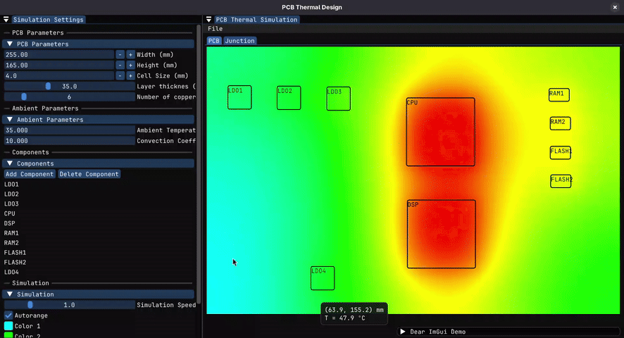

# PCB Thermal Simulation



A lightweight interactive 2D thermal simulator for printed circuit boards (PCBs) built with **C++**, **OpenGL 3.3**, and **Dear ImGui**.

This tool visualizes heat distribution and dissipation across a PCB in real time by numerically solving the **2D heat equation (Finite Difference Method / FDM)**, rendering a dynamic heatmap directly over the board geometry.

<!---->


---

## Features

* **Real-Time Simulation:** Iterative thermal conduction calculations using a 2D numerical grid.
* **Dynamic Heatmap:** Maps scalar temperature values to color palettes rendered directly on the GPU via OpenGL textures.
* **Intuitive User Interface:** Interactive controls using Dear ImGui to modify PCB dimensions, grid resolution, and ambient thermal conditions.
* **Spot Inspection:** Query exact temperature values at any point on the board by hovering with the mouse (*hover tooltip*).
* **Self-Contained & Cross-Platform:** Configured with CMake to automatically download and build dependencies on Linux, Windows, and macOS.

---

## Build and Run Instructions

Follow these simple steps for your operating system. No need to manually install GLFW or ImGui, as the project handles its own dependencies.

### Prerequisites
Before getting started, ensure you have installed:

1. A C++ compiler:
    - **Linux:** `g++` or `clang`
    - **Windows:** Visual Studio or MinGW
    - **macOS:** Xcode Command Line Tools   
2. CMake (Version 3.12 or higher)
3. Git

### Building the project

Clone the repository in a folder of your choice and use CMake to build the source files.

There are two CMake presets already preconfigured in the `CMakePresets.json` file:
- **Release:** Compiles only the necesary files and enables compiler optimization. Recommended for most people.
```
cmake --preset "release" && cmake --build build/release
./build/release/PCB_Thermal_Design
```

- **Debug:** Includes ImGui's default demo window and enables compiler warning. Recommended for those who want to modify the source code or implement new features.
```
cmake --preset "debug" && cmake --build build/debug
./build/debug/PCB_Thermal_Design
```

You can also use **CMake GUI** to configure and generate the files to build the project.

---

## Usage

The application consists on two separate panels that work together: the **settings panel** and the **visualizing panel**.

### The settings panel:
This is where you configure all the parameters for the simulation.
#### PCB Parameters
This tab holds all the phisical parameters related to the structure of the circuit board.
- **Width:** width of the PCB in mm
- **Height:** height of the PCB in mm
- **Cell Size:** size of the discrete cells used to compute the temperatures in mm
- **Layer thickness:** thickness of the copper layers in um. Used to determine the section area for lateral diffusion. The most common value is 35 um.
- **Number of copper planes:** number of layers that are aproximately continuous (i.e. power planes, GND planes, ...).

#### Ambient Parameters
- **Ambient Temperature:** Temperature of the surrounding air in ºC.
- **Convection Coefficient:** Convection coefficient in W/m²K. Typical values are around 10 W/m²K for natural convection (taking into account heat radiation).

#### Components
This section provides an interface for adding and editing components and potential heat sources.

#### Simulation


### The visualizing panel


---

## Project Structure

The project follows a clean structure separating the UI, physics engine, and third-party libraries:

```text
PCB-Thermal-Design/
├── CMakeLists.txt          # CMake build system configuration
├── CMakePresets.json       # CMake presets for configuration
├── README.md               # Project documentation
├── include/                # Header files (.h)
│   ├── application.h       # Window management and ImGui interface
│   └── pcb.h               # PCB logic and thermal physics
├── src/                    # Source files (.cpp)
│   ├── main.cpp            # Application entry point and main loop
│   ├── application.cpp     # UI implementation (Viewport and Panels)
│   └── pcb.cpp             # Thermal physics and color map implementation
├── imgui/                  # Imgui and OpenGL backend source files
└── build/                  # Directory for project building 
    ├── debug/              # Debug configuration
    └── release/            # Release configuration
``` 
---
## Acknowledgments

The idea of this project came with a cool subject of the Electronic Systems Master's Degree of the Politechnic University of Valencia: *Thermal Design and EMC in Electronic Products*